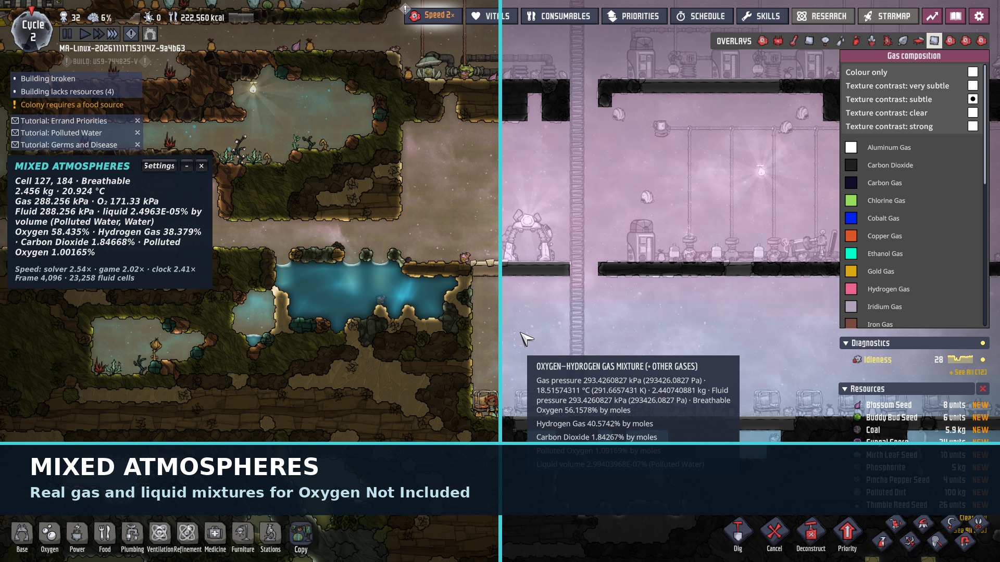

# Mixed Atmospheres: issue board

Mixed Atmospheres is a mod for Oxygen Not Included that makes air and liquids
behave more like the real thing: gases mix together in a room instead of
sitting in separate tiles, and liquids blend or settle into layers.

This repository is the place to **report problems and ask questions**. It
holds no mod code.

## Report a problem

1. Open the [Issues tab](https://github.com/Henry147147/oni_gas_mod_issue_board/issues) and choose **New issue**.
2. Say what you were doing, what you expected and what happened instead.
3. Attach your `Player.log`. The game writes it here:
   - Windows: `%USERPROFILE%\AppData\LocalLow\Klei\Oxygen Not Included\Player.log`
   - Linux: `~/.config/unity3d/Klei/Oxygen Not Included/Player.log`
4. A screenshot or the save file helps a lot.

The log is replaced each time the game starts, so copy it before you launch
the game again.

## Steam page material

Everything for the Steam Workshop page is in [`steam/`](steam/):

| File | What it is |
| --- | --- |
| [steam/README.md](steam/README.md) | Step-by-step upload checklist |
| [steam/STORE_PAGE.md](steam/STORE_PAGE.md) | The page text, easy to read and review |
| [steam/workshop-description.bbcode](steam/workshop-description.bbcode) | The same text, ready to paste into Steam |
| [steam/preview.png](steam/preview.png) | Square thumbnail for the Workshop |
| [steam/screenshots/](steam/screenshots/) | Six screenshots, with and without captions, plus a header image |
| [steam/videos/](steam/videos/) | A trailer and two short clips |
| [steam/overlay-tour.gif](steam/overlay-tour.gif) | Small animation of the four new overlays |
