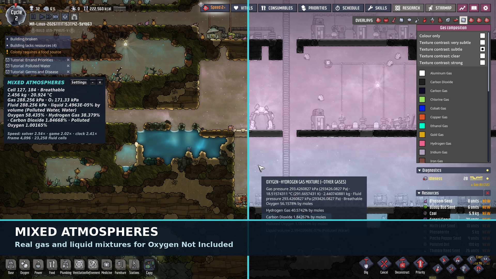
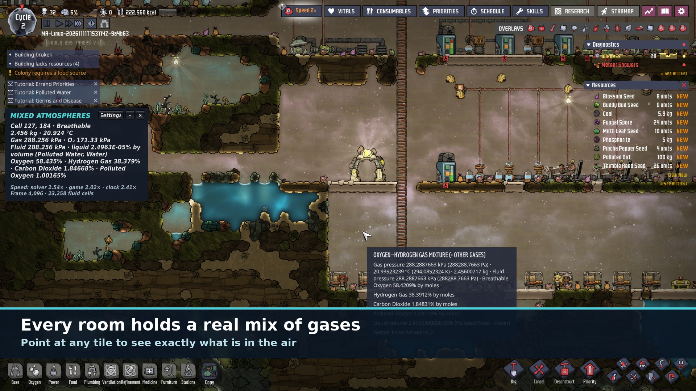
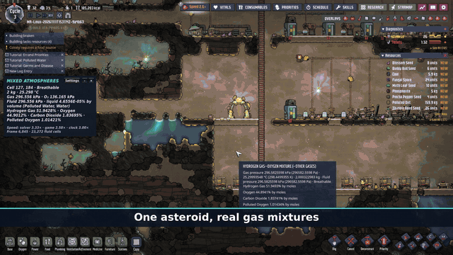
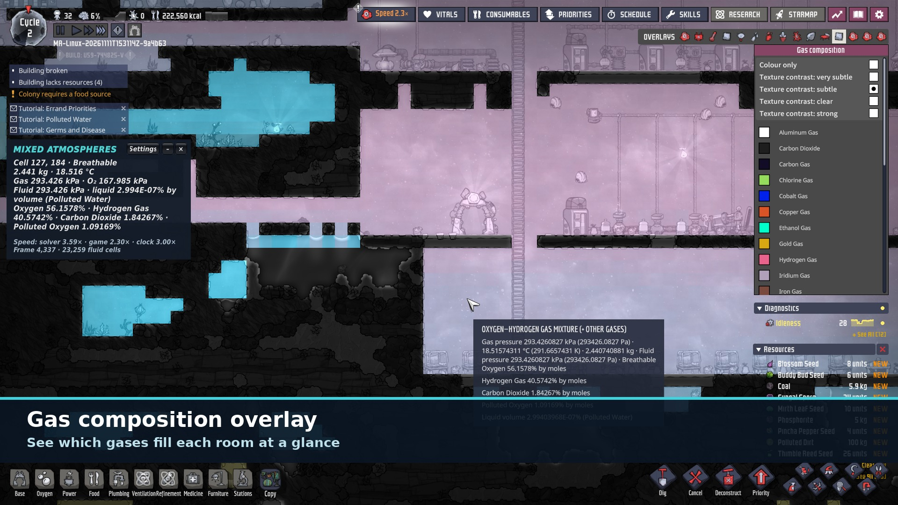
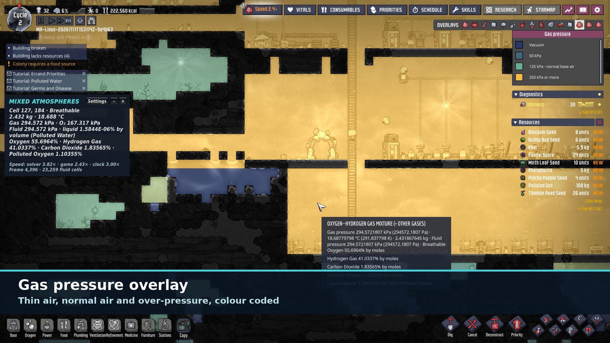
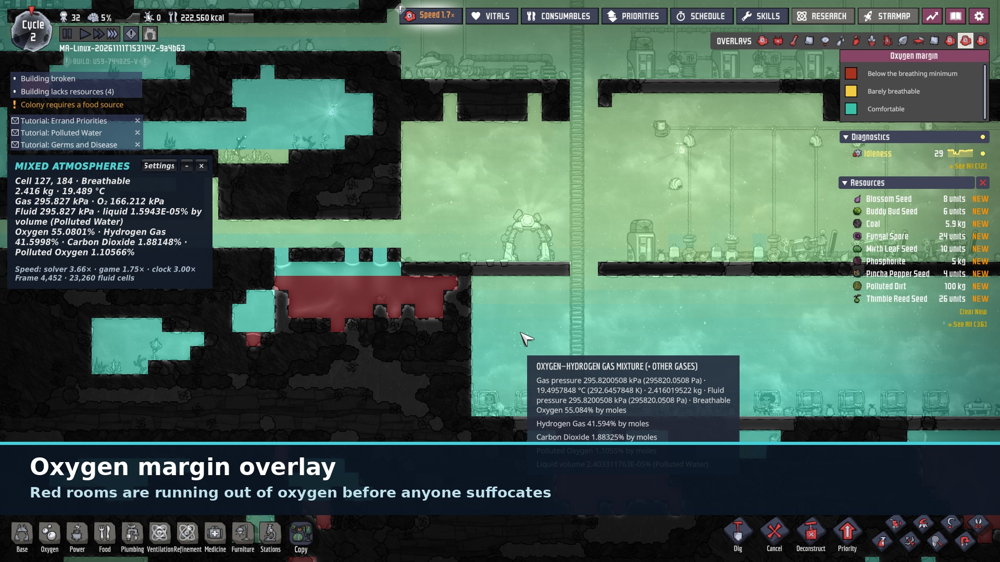
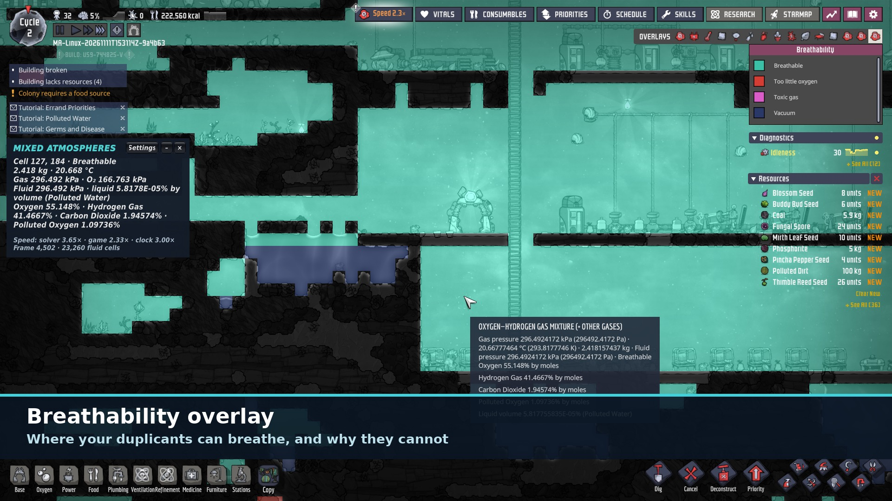
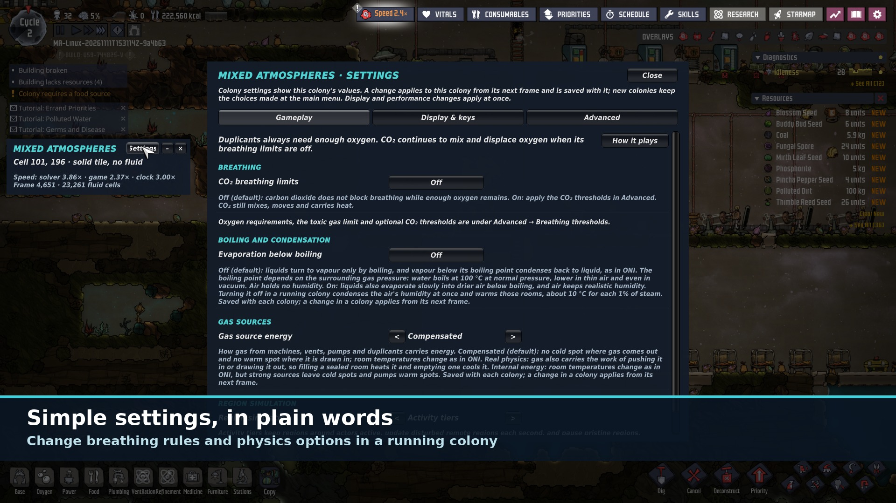

# Mixed Atmospheres: Steam Workshop page

This is the text for the Workshop page, written to be read by someone who has
played Oxygen Not Included but knows nothing about how the mod works inside.
The paste-ready version is
[workshop-description.bbcode](workshop-description.bbcode); keep the two in
step when you edit.

**Title:** Mixed Atmospheres: real gas and liquid mixtures

**One-line summary:** Air that mixes like real air. Gases share a room,
liquids blend or layer, and pipes carry whatever you pump into them.

**Suggested tags:** Gameplay, Simulation, Base Game, Spaced Out!

---

## What is this?

In the normal game, every tile holds exactly one gas. Oxygen sits in one tile,
carbon dioxide in the next, and they shuffle past each other.

With Mixed Atmospheres, a tile holds **a mix**, like real air. A bedroom can be
80% oxygen, 18% hydrogen and 2% carbon dioxide all at once. Liquids follow the
same idea: some blend together, others settle into layers.

The mod replaces the game's gas and liquid behaviour. Everything else
(duplicants, buildings, critters, plants, digging) is still the game you know.

## What changes when you play

- **Gases mix and stay mixed.** Carbon dioxide spreads through a room instead
  of collecting in one pit at the bottom of your base.
- **Liquids act like liquids.** Liquids that can blend do. Liquids that cannot
  settle into visible layers. You can no longer squeeze tonnes of water into a
  single tile.
- **Pressure matters.** Gas squeezes together, and rushes out into empty space
  if you open a room to vacuum. Water boils more easily in thin air.
- **Pumps and pipes carry the mix.** A pump takes whatever is at its intake. A
  filter pulls out the one thing you choose and lets the rest through.
- **Breathing depends on the mix.** Duplicants need enough oxygen in the air
  around them. A room full of gas is no help if too little of it is oxygen.
- **You can see all of it.** Four new overlays and a hover readout show what
  is in the air anywhere on the map.

## The new overlays

Open them from the Overlays bar at the top right, next to the game's own.

| Overlay | What it tells you |
| --- | --- |
| **Gas composition** | Which gases are in each room |
| **Gas pressure** | Where air is thin, normal or dangerously dense |
| **Oxygen margin** | How much spare oxygen a room has. Red means it is nearly out. |
| **Breathability** | Where duplicants can breathe, and the reason if they cannot |

## Getting started

1. Subscribe, start the game, open **Mods** and turn on **Mixed Atmospheres**.
2. Restart when the game asks.
3. Start a **new colony**. The mod does not change colonies you already have.
4. You begin with a little extra oxylite beside the printing pod. It covers
   about ten cycles, so build a steady oxygen supply early.

Tip: watch the **Oxygen margin** overlay. It warns you that a room is running
low well before anyone starts gasping.

## Settings

Press **Settings** on the Mixed Atmospheres panel in the game, or on the mod's
row in the Mods screen. The defaults suit most players. The first page has the
options you are most likely to want:

- **CO₂ breathing limits** (off by default). Turn this on for a harder game
  where too much carbon dioxide makes a room unbreathable.
- **Evaporation below boiling** (off by default). Turn this on for humid air
  and puddles that slowly dry out.

Settings are saved with each colony and can be changed while you play.

## What you need

- **Windows or Linux**, 64-bit. On a Mac the mod switches itself off and the
  game plays as normal.
- **The base game**, with or without **Spaced Out!**
- The Frosty, Bionic, Prehistoric and Aquatic packs are not supported yet.
  While one of them is on, your colonies use the game's normal behaviour and
  the main menu tells you so.

## Please read before you start

- **Speed.** Working out real mixtures takes more computer power than the
  normal game. Small and mid-sized colonies run well. Very large colonies may
  not keep up with the fastest game speed, and things like a meteor shower
  hitting an open surface can slow the clock for a while. The camera, menus
  and pause always stay responsive. A recent processor with several cores
  helps.
- **Saves.** A colony started with this mod needs the mod to load. It cannot
  go back to the normal game. Colonies you made without the mod are left
  exactly as they are. Keep a backup of anything you care about.
- **Game updates.** After a game update the mod checks that everything it
  relies on is unchanged. If something changed, the mod switches itself off
  with a message and leaves your colonies untouched until a mod update is out.
- **Other mods.** Mods that change gases, liquids or pipes will probably not
  work alongside this one.

## If something goes wrong

If the mod reaches a state it cannot safely continue from, gases and liquids
stop moving, a message tells you, and saving is blocked so a broken colony is
never written over a good one. Load your last save to carry on.

Please report it at
<https://github.com/Henry147147/oni_gas_mod_issue_board/issues> and attach
your `Player.log`:

- Windows: `%USERPROFILE%\AppData\LocalLow\Klei\Oxygen Not Included\Player.log`
- Linux: `~/.config/unity3d/Klei/Oxygen Not Included/Player.log`

## Common questions

**Will it break my existing colony?**
No. Existing colonies keep the game's normal behaviour.

**Can I remove the mod later?**
Yes, but colonies started with it will no longer load. Your other colonies are
unaffected.

**Is it harder than the normal game?**
A little different rather than harder. Carbon dioxide no longer sinks out of
the way by itself, so plan for fresh oxygen and good airflow. The default
breathing rules are forgiving.

**Why is there hydrogen in the screenshots?**
They show a busy test colony whose machines release hydrogen into the air.
With this mod it mixes into the room instead of floating to the ceiling, and
the readout shows exactly how much.

**Does it work in multiplayer or on a Steam Deck?**
The game is single-player. Steam Deck has not been tested.
